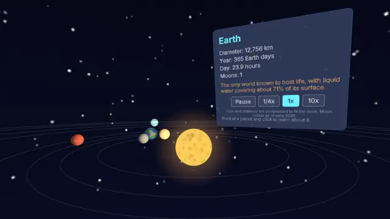
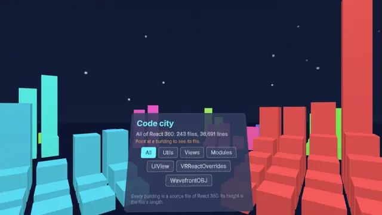
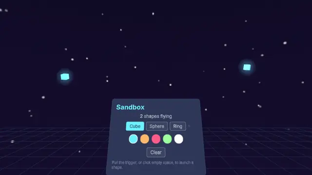
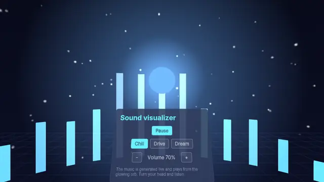

<p align="center">
  
</p>

<p align="center">
  <b>Facebook's React 360, ported from WebVR to WebXR.</b><br>
  Build 360 and VR experiences with React, and step into them on today's headsets.
</p>

<p align="center">
  
  
  
  
  
</p>

<p align="center">
  <a href="#try-it-in-two-minutes">Try it</a> ·
  <a href="#the-examples">Examples</a> ·
  <a href="#what-changed-from-the-archive">What changed</a> ·
  <a href="#a-modern-runtime-too">Modern runtime</a> ·
  <a href="#start-your-own-app">Start your own app</a> ·
  <a href="WEBXR_STATUS.md">Status</a>
</p>

<p align="center">
  <a href="examples/solar-system"></a>
</p>

<table>
  <tr>
    <td width="33%" valign="top">
      <h3>It enters VR again</h3>
      Browsers removed WebVR, and every React 360 app lost its "View in VR" button. This fork gives it back, on WebXR.
    </td>
    <td width="33%" valign="top">
      <h3>Point, pinch or look</h3>
      Controllers, tracked hands and gaze all arrive as the same <code>onClick</code>. Thumbsticks report too.
    </td>
    <td width="33%" valign="top">
      <h3>No headset needed</h3>
      Add <code>?emulate</code> to the address and a virtual Quest 3 runs a real VR session in your desktop browser.
    </td>
  </tr>
</table>

## Why this exists

React 360 let you write VR the way you write a web page: components, props,
state and Flexbox, drawn on panels floating in a 360 world. Facebook archived
it in 2020. It was built on WebVR, and browsers have since removed WebVR, so
every React 360 app lost its "View in VR" button.

This fork puts it back. The runtime now speaks the WebXR Device API, so the
same apps enter VR again on current browsers and headsets, with controllers,
tracked hands or gaze. Along the way it picked up React hooks, thumbstick
events and a test suite that runs a whole VR session without a headset.

```js
import React, {useState} from 'react';
import {AppRegistry, Text, View, VrButton} from 'react-360';

function Hello() {
  const [count, setCount] = useState(0);
  return (
    <View style={{padding: 30, backgroundColor: 'rgba(10, 20, 40, 0.8)'}}>
      <VrButton onClick={() => setCount(count + 1)}>
        <Text style={{fontSize: 40}}>Pinched {count} times</Text>
      </VrButton>
    </View>
  );
}

AppRegistry.registerComponent('Hello', () => Hello);
```

Point at it with a controller and pull the trigger, or put the controllers
down and pinch. It is the same `onClick`.

## Try it in two minutes

You need Node.js and npm. The port is developed and tested on Node 22.

```bash
cd webxr-demo
npm install
npm start
```

Open http://localhost:8081/index.html, then pick how you want to go in:

| You have | Do this |
| --- | --- |
| **No headset** | Open http://localhost:8081/index.html?emulate. Meta's WebXR emulator loads as a virtual Quest 3, and "View in VR" starts a real WebXR session in your desktop browser. |
| **A Meta Quest** | Connect it over USB, run `adb reverse tcp:8081 tcp:8081`, and open `http://localhost:8081/index.html` in the Quest browser. |
| **Another headset on your network** | Run `npm start -- --https` and open `https://<your computer's IP>:8081/index.html`. WebXR needs a secure context. |

[`webxr-demo/README.md`](webxr-demo/README.md) has the details.

## The examples

Four demos written for this fork, each a few hundred lines of React. No
downloaded art: the geometry, textures and music are all generated in code.

<table>
  <tr>
    <td width="50%">
      <a href="examples/solar-system"></a><br>
      <b><a href="examples/solar-system">Solar system</a></b><br>
      Point at a planet to read about it, and change the speed of time.
    </td>
    <td width="50%">
      <a href="examples/code-city"></a><br>
      <b><a href="examples/code-city">Code city</a></b><br>
      React 360's own source as a city: one building per file, as tall as the file is long.
    </td>
  </tr>
  <tr>
    <td width="50%">
      <a href="examples/controller-sandbox"></a><br>
      <b><a href="examples/controller-sandbox">Controller sandbox</a></b><br>
      Pull the trigger to launch glowing shapes that float and bounce.
    </td>
    <td width="50%">
      <a href="examples/sound-visualizer"></a><br>
      <b><a href="examples/sound-visualizer">Sound visualizer</a></b><br>
      Music generated live in the browser. Turn your head and hear it move.
    </td>
  </tr>
</table>

```bash
cd examples
npm install
npm start
```

Then open http://localhost:8081/index.html for a landing page that links to
each one, with and without the emulator.
[`examples/README.md`](examples/README.md) explains how they are built.

## What changed from the archive

Everything is built on Facebook's last commit, with their history intact.

| | Facebook's archive (2020) | This fork |
| --- | --- | --- |
| VR API | WebVR, which browsers have removed | WebXR |
| Enters VR today | No | Yes |
| Controllers | Through the Gamepad API | Through the WebXR session, with a pointer beam that follows the hand you last used |
| Tracked hands | Not supported | Point and pinch |
| Thumbsticks and touchpads | Never reported | `axis` input events |
| `ControllerInfo` | Gamepads only | Headset controllers and hands too, as they are picked up and put down |
| Recentering | Not reported | A `recenter` event |
| React | 16.3, React Native 0.55 | 16.8, React Native 0.59, so components can use hooks |
| Runs on current Node | No | Yes |
| Tests | Unit tests | Unit tests for the WebXR session, pointer and controllers, plus a smoke test that drives a full VR session in an emulated headset |
| Runnable demo in the repo | None | `webxr-demo` and four examples |

What did not change: the React 360 API. `View`, `Text`, `VrButton`, `Surface`,
`Environment`, `asset()` and the rest work as the [documentation](docs)
describes, so most existing apps need no code changes. Apps whose `client.js`
reached into the VR internals do; the "WebXR" section of
[`React360/README.md`](React360/README.md) lists what moved.

## A modern runtime, too

The port keeps the 2019 stack so that old apps run unchanged. For new work,
[`modern/`](modern/README.md) is a second runtime with the same API on
today's tools:

| | The port (`React360/`) | The modern runtime (`modern/`) |
| --- | --- | --- |
| React | 16.8, through React Native 0.59 | 19 |
| three.js | r87 (2017) | r187 |
| Bundler | Metro | Vite |
| Rendering | Its own renderer in a web worker | [react-three-fiber](https://github.com/pmndrs/react-three-fiber), [uikit](https://github.com/pmndrs/uikit) and [@react-three/xr](https://github.com/pmndrs/xr) |

Apps still import `View`, `Text`, `VrButton`, `Environment` and the rest
from `react-360`. It runs the demo and all four examples, three of them needing only a new
setup file, and it accepts custom views and native modules written
for the original runtime.

```bash
cd modern
npm install
npm start
```

Then open http://localhost:8083/index.html, or add `?emulate` for the virtual
headset. It is newer and less proven than the port: it has been checked on the
page and in the emulator, not yet on a headset. Its
[README](modern/README.md) lists what it covers and what is still missing.

## What's in the repository

| Folder | What it is |
| --- | --- |
| [`React360/`](React360/README.md) | The web runtime (`react-360-web`), ported from WebVR to WebXR. |
| [`Libraries/`](Libraries) | The React components (`react-360`), updated to React 16.8 and React Native 0.59. |
| [`webxr-demo/`](webxr-demo/README.md) | A runnable app on both, with the fixes its 2019 toolchain needs on current Node. It also holds the runtime's tests. Start here. |
| [`examples/`](examples/README.md) | The four demos above. |
| [`modern/`](modern/README.md) | The modern runtime: the same API on React 19, current three.js and Vite, with its own tests. It loads the demo's assets and the examples from the folders above. |
| [`Samples/`](Samples) | Facebook's original sample apps, as source: templates for tours and media, and samples for native modules, multiple roots, custom video players and head-locked surfaces. They are not set up to run by themselves; `webxr-demo/` is the `BasicAppTemplate` sample made runnable, and the others can be brought across the same way. |
| [`docs/`](docs) | The original React 360 documentation. |
| [`WEBXR_STATUS.md`](WEBXR_STATUS.md) | What the port covers, what has been checked and how, and what is still open. |

The rest is the archived project as Facebook left it. That includes
[`packages/`](packages/README.md), an unreleased next-generation runtime that
still uses WebVR and is not part of this port.

## Start your own app

The port is not on npm yet. `react-360` and `react-360-web` there are still
the 2019 WebVR releases, and `react-360 init` scaffolds against them. Until
that changes, build from a checkout of this repository:

1. Copy `webxr-demo/` to a new folder beside it, and rename the app in
   `package.json`, `client.js` and `index.js`.
2. Run `npm install` and `npm start` in it.
3. Write your app in `index.js`.

The copy has to stay beside `React360/` and `Libraries/`, because its
`metro.config.js` loads both from there.

To move an existing React 360 app onto the port, start from a copy of
`webxr-demo/` the same way and bring your `index.js`, components and
`static_assets/` across.

## Tests

```bash
cd webxr-demo
npm test        # the runtime's unit tests
npm run smoke   # a whole VR session against the emulated headset
```

The smoke test opens the demo in headless Chrome with an emulated Quest 3,
clicks "View in VR", pulls a trigger, pushes a thumbstick, swaps the
controllers for hands, pinches, and leaves again, checking what the runtime
makes of each step.

The modern runtime has its own: `npm test` and `npm run smoke` in `modern/`.

## Status

The port is a restoration, not a rewrite. three.js stays at r87 and the bundler is
still Metro from the React Native 0.59 era, so that existing apps keep working
unchanged. The port is developed against the emulator, with checks on a Meta
Quest. [`WEBXR_STATUS.md`](WEBXR_STATUS.md) lists what has only been checked in
the emulator, and what is still open (publishing to npm is the big one). The
rewrite on a current stack is under way beside it, in
[`modern/`](modern/README.md).

Issues and pull requests are welcome. If you report a bug, include the
browser, the headset and what you saw.

## Credits and license

React 360 was created by Facebook and Oculus, and its authors' history is
preserved here. It is [BSD licensed](./LICENSE). Its documentation is
[Creative Commons licensed](./LICENSE-docs), and the samples are
[separately licensed](./LICENSE-examples). The WebXR port and the new examples
are offered under the same terms.

"View in VR" without a headset is thanks to
[IWER](https://github.com/meta-quest/immersive-web-emulation-runtime), Meta's
Immersive Web Emulation Runtime.
